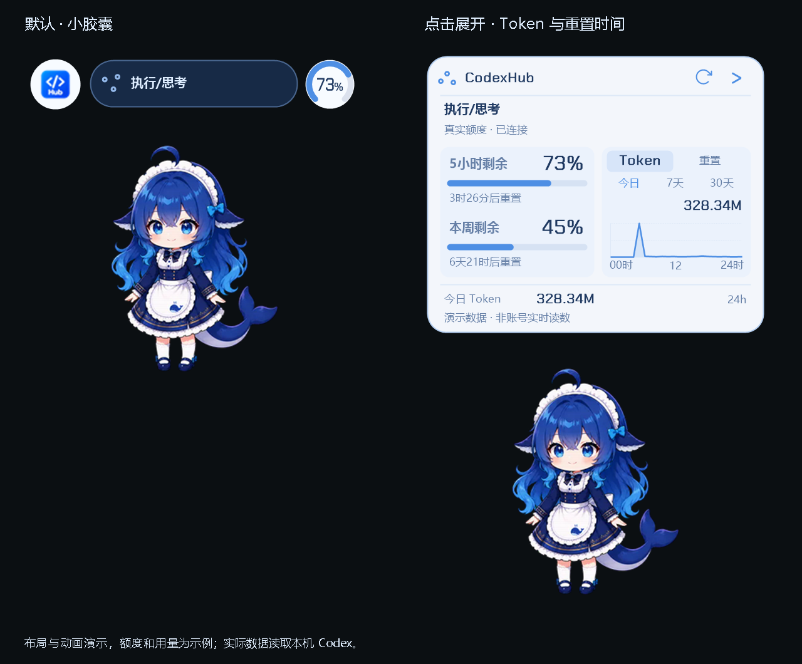
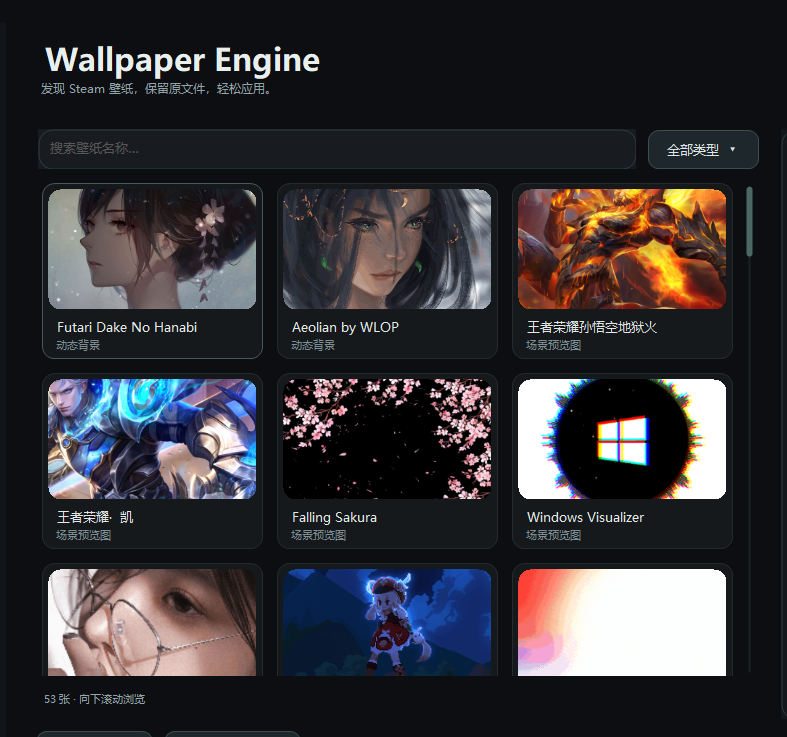

# CodexHub

让 Codex 换上喜欢的风景，也有一个会动的小伙伴。

把 **动态背景、桌面宠物和真实额度提醒** 放进同一个 Windows 软件。支持 4K 视频、Wallpaper Engine 壁纸库、拖动与随机行走，以及点击展开的额度小卡片。

功能预览分支：`feature/pet-companion`。基于 v1.5.4.5，保留托盘按钮修复。

**[CodexHub 功能预览版](https://github.com/chenyan-image/codex-live-background/releases/tag/v1.7.0-preview.2) · [动态背景稳定版](https://github.com/chenyan-image/codex-live-background/releases/latest) · [更新记录](CHANGELOG.md) · [详细说明](docs/guide.md)**

CodexHub v1.7.0-preview.2 增加「桌面宠物」页面，稳定主线仍为 v1.5.4.5。预览版沿用安装身份和资料路径，避免改名造成重复安装。

## 特点

- **桌面宠物**：保留鲸鱼娘、鲸鱼女仆，另有白龙娘与小蕾米的作者素材加载入口。支持拖动、松手惯性滑行、随机行走和右键选动作；左右键轻微按压回弹，左键点击音效已内置，右键静音。
- **两种活动范围**：仅在 Codex 内活动，或在整个桌面活动；支持跨屏拖动，窗口内模式会跟随窗口移动、碰壁回弹，最小化时隐藏。
- **独立大小与置顶**：宠物、胶囊分别调节大小，滑杆范围仍为 70%～150%。宠物新的 100% 相当于原来的 140%，胶囊默认 100%。点击其它程序时保持置顶；黑色圆角菜单点击外部关闭，右键时管理器留在后台、不新增任务栏图标。
- **任务与额度分开看**：点击宠物上方的蓝色胶囊，平滑展开当前任务、执行阶段和最近的操作；点击右侧圆环，展开额度、Token 曲线和重置时间。卡片从胶囊／圆环位置逐步向上展开，身体位置与大小固定；执行／思考时状态图标旋转；手动刷新额度时刷新图标也会旋转。
- **完整动作链**：收到任务进入工作，任务结束播放完成动作；空闲随机播放日常动作，五分钟无任务后休息。正常切换等待当前动作播完，拖拽和碰撞即时响应。所有宠物共用活动范围、惯性、走动和菜单操作，手动动作来自各自素材。
- **离线碎碎念**：内置中文文案，不调用 Codex、不消耗额度；每个宠物分别设置自动开关、间隔和动作权重，右键可随时说一句或进行简单离线互动。
- **本机 Token 曲线**：显示今日、7 天和 30 天用量，增量读取本机记录，兼容新旧格式并去重；统计含缓存输入，与账户计费口径不同。没有数据时显示未知或暂无记录。

- **4K 视频背景**：优先使用原画质；电脑无法解码时自动生成兼容副本，并按需降低分辨率。
- **图片铺满窗口**：横图、方图、竖图都按比例裁切铺满 Codex，覆盖侧栏和对话区域；聊天框透明度可调。
- **Wallpaper Engine 壁纸库**：自动查找 Steam 库中的视频、GIF 和图片，支持搜索、类型筛选、连续向下滚动和预览。
- **壁纸记录与内置背景**：保存最近使用的壁纸，内置六张轻量原创背景，可导入自己的图片和视频。
- **4096 字符长名称**：主题名称及壁纸标题最多支持 **4096 个 Unicode 字符**，支持中文、英文和表情；Steam 标题不再截到 160 字符，导入、保存和加载使用统一上限。
- **自动恢复**：服务随 Windows 登录运行，Codex 打开后恢复背景，无需一直开着管理器。左下角显示连接、服务和实际播放状态，点击可重新检测。
- **托盘后台运行**：管理器最小化或关闭时隐藏到右下角托盘，不占任务栏；双击托盘图标恢复，右键可彻底退出管理器，背景服务独立运行。
- **任务栏入口修复**：快捷方式改用稳定的官方应用入口，统一启动标识；普通版与 Beta 分别识别，避免旧路径失效、同频道归组不一致及重复打开现有窗口。
- **统一安装与卸载**：安装路径可选其他本地盘，桌面仅一个图标；升级先移除旧版，安装目录内附独立卸载工具，统一清理后台组件与缓存。

## 支持格式

| 类型 | 文件格式 | 支持与处理方式 |
| --- | --- | --- |
| 视频 | **MP4** | 支持 H.264 / AVC、H.265 / HEVC；AV1、分片 MP4 等需要兼容处理的输入会先转换，再验证实际解码。 |
| 视频 | **WebM** | 支持 VP8 / VP9 输入，需要时生成 VP9 兼容副本。 |
| 动图 | **GIF** | 循环播放，可直接作为动态背景。 |
| 图片 | **PNG** | 按比例裁切铺满窗口，保留聊天框透明度设置。 |
| 图片 | **JPG / JPEG** | 支持横图、方图和竖图，自动适配窗口。 |
| 图片 | **WebP** | 可导入、预览并应用为图片背景。 |
| Wallpaper Engine | **视频 / GIF / 图片项目** | 自动扫描 Steam 库，也可手动定位目录；支持搜索、筛选和预览。 |
| Wallpaper Engine | **scene.pkg / 网页 / 应用项目** | 有预览图时可使用预览图，原场景动画、网页和程序不能直接播放。 |

| 项目 | 范围与限制 |
| --- | --- |
| 主题名称 / 壁纸标题 | 最多 **4096 个 Unicode 码点**；组合表情按所含码点计数，名称不允许换行或控制字符。 |
| **4K 视频** | 原画质优先；需要兼容转换时，先保留源尺寸（长边最高 4096），再按需降至长边 2560、1920 像素。 |
| 文件大小 | 视频源文件最大 **2 GiB**，图片最大 **512 MiB**；最终播放副本最大 **512 MiB**。 |
| 视频时长与帧率 | 最长 **10 分钟**，输入最高 **120 FPS**；兼容副本最高 **30 FPS**。 |
| 分辨率与动画 | 单边最高 **16384 像素**，总像素最高 **50 MP**；图片动画最多 **300 帧**。 |
| 播放方式 | 视频静音循环；转换保留完整时长，原素材不被修改。 |

本预览 EXE 已包含校验过的 FFmpeg 运行时，用于透明桌宠和视频兼容处理，无需额外安装解码器。[兼容与离线使用说明](docs/guide.md#首次转换需要的下载)

## 内置宠物

| 形象 | 动作 |
| --- | --- |
| 鲸鱼娘 · DeepSeek | keleus 的 29 张整身表情与帧素材，组成 31 项表情／轻动画；含眨眼、敲键盘和程序轻摆，不将静态表情冒称为完整逐帧动画 |
| 鲸鱼女仆 | PC2005-cloud/dsh-pet 的 **106 段完整透明动画，640×360 / 24 FPS**；待机、移动、小动作、玩耍、饮食、时节、六档额度回应和六种工作状态 |
| 白龙娘（按需加载） | 完整 25 段动画：贴贴、傲娇、比心、龙族契约、收到任务、处理任务、整理归档、翻阅资料等，右键选择 |
| 小蕾米（按需加载） | 9 种基础动作与 v2 注视帧 |

宠物可直接切换，设置会保存。右键宠物可查看动作、刷新额度或打开设置；关闭管理器隐藏到托盘后宠物继续运行，选择「退出管理器」会一起退出宠物，背景服务独立运行。

白龙娘优先加载本机原素材，也可直接从作者发布下载；原包约 589 MiB，本地转换为 **24 FPS、336×384** 的完整透明动画，按每帧实际时长播放。小蕾米从作者固定版本下载约 3 MiB 的原图集并在本地转换。安装包只附这两者的入口和来源清单，原素材不重新托管。

## 界面

桌面宠物与设置：

默认小胶囊与额度圆环，分别展开任务、额度卡片：

图中额度、重置时间和曲线为演示数据；实际运行读取本机登录账号及本机用量记录。默认胶囊的动画预览：

离线碎碎念：蓝色气泡、尾巴与爱心，文字放大显示。

本地壁纸与预览：

Wallpaper Engine 壁纸库（本机实际扫描），向下连续滚动浏览：

壁纸部分附六张轻量原创背景。宠物列表保留上表四项，白龙娘与小蕾米按需加载。Wallpaper Engine 页来自本机真实壁纸库，截图中的第三方素材需从自己的电脑导入或扫描；场景项目只能使用预览图。

## 使用

1. 在 [功能预览发行页](https://github.com/chenyan-image/codex-live-background/releases/tag/v1.7.0-preview.2) 下载 **`CodexHub-1.7.0-preview.2-Setup.exe`**，双击安装并选择目标路径，无需解压。安装窗会保留到操作结束。
2. 导入本地素材，或在 Wallpaper Engine 页面选择壁纸。
3. 右侧预览后点击「应用这张壁纸」。最小化或关闭管理器会隐藏至托盘；右键托盘选择「退出管理器」可退出，背景仍继续运行。

完整卸载可运行安装目录中的「卸载 CodexHub.exe」，或在 Windows 设置中卸载；先停止本项目后台进程，再移除服务、程序和生成缓存。外部壁纸原文件和 Codex 登录资料保留。新安装包也提供「只卸载旧版本」，用于处理旧安装。

新装和新版卸载不使用 MSI。已有旧 MSI 时，会先备份核验过的旧文件，再通过 Windows Installer 正式移除旧产品；这一步可能需要原账号的 Windows 授权，缓存缺失时会校验并恢复原版安装源。失败时保留日志及恢复文件，不继续覆盖。

适用 **Windows 10 / 11 x64 + 官方 Codex 稳定版**。首次开启背景连接时，若提示普通启动实例，请保存输入后手动完全退出 Codex 一次，再应用壁纸。

本工具为非官方项目，与 OpenAI 无隶属关系。当前安装包尚未正式代码签名，Windows 可能提示未知发布者；详见 [发布说明](docs/windows-trust.md)。

[MIT](LICENSE) · [第三方声明](THIRD_PARTY_NOTICES.md) · [构建与开发](docs/guide.md#从源码构建)

## 来源与致谢

| 项目／素材 | 用途 |
| --- | --- |
| [xxloocee/Codex-Dream-Skin-Manager](https://github.com/xxloocee/Codex-Dream-Skin-Manager) | 原始背景管理器。本仓库在其基础上修复 Bug、简化源码和改善 Windows 体验。 |
| [Fei-Away/Codex-Dream-Skin](https://github.com/Fei-Away/Codex-Dream-Skin) | 底层背景引擎，保留原有许可与声明。 |
| [jingh12312-rgb/bailong-desktop-pet](https://github.com/jingh12312-rgb/bailong-desktop-pet) | 白龙娘及原始动作素材来源，使用作者原素材加载入口。 |
| [Wunsch2048/codex-bailong-desktop-pet](https://github.com/Wunsch2048/codex-bailong-desktop-pet) | 桌宠互动、额度胶囊、Token 卡片与字体的参考，以及作者原素材下载入口；不重新分发其源码或角色图像。 |
| [YaKun9/codex-pets](https://github.com/YaKun9/codex-pets) | 历史版本使用过的奥黛塔、爱弥斯、穗穗与流萤素材；本预览已从列表和安装包移除。 |
| [HanaAyane/remielle-codex-pet](https://github.com/HanaAyane/remielle-codex-pet) | 小蕾米。作者注明原素材经过 AI 辅助重绘与人工整理；通过作者原仓库加载，保留原 [使用说明](https://github.com/HanaAyane/remielle-codex-pet/blob/main/ASSET-USAGE.md) 和 [声明](https://github.com/HanaAyane/remielle-codex-pet/blob/main/NOTICE.md)。 |
| [T-Zevin/Awesome-Codex-Pets](https://github.com/T-Zevin/Awesome-Codex-Pets) | 社区宠物、网站与工具导航参考，不把导航中的全部项目视为随包素材。 |
| [PC2005-cloud/dsh-pet](https://github.com/PC2005-cloud/dsh-pet) | 鲸鱼女仆的全部 106 段生产透明动画及相关媒体；原始 MIT 许可、固定版本、文件哈希和映射随包保留。采用本地播放器和原创离线文案，不引入 DSH 宿主或模型调用。 |
| [keleus/deepseek-pet](https://github.com/keleus/deepseek-pet) | 当前鲸鱼娘整身表情素材；转换透明 PNG 并加入轻动画，保留 MIT 原文。替换了原先的鲸鱼娘图集。 |
| [gmskywalker/deepseek-fat-fish-codex-pet](https://github.com/gmskywalker/deepseek-fat-fish-codex-pet)、[YunYueSama/codex-deepseek-pet](https://github.com/YunYueSama/codex-deepseek-pet) | 历史大肥鱼合集来源；本预览已替换为鲸鱼女仆，不再附旧图集。 |
| [ChaozhongLiu/DyberPet](https://github.com/ChaozhongLiu/DyberPet) | 历史动画素材参考；本预览已移除小猫、圣诞小猫和派蒙。 |
| [Petdex](https://petdex.dev/zh) | Boba（railly）、Tiko（huigegood）、Wangcai（boxu-openai）；此前鲸鱼娘图集的来源。 |
| [Codex Pet](https://codexpet.xyz/) | Codie 图集与 pet.json 图集格式参考。 |
| [JiPaiFan1109/CodexPage](https://github.com/JiPaiFan1109/CodexPage) | 壁纸管理布局的参考。 |
| [Chakra Petch](https://fonts.google.com/specimen/Chakra+Petch) | 额度数字字体，SIL OFL。 |
| [Node.js](https://nodejs.org/)、[FFmpeg](https://ffmpeg.org/)、[Phosphor Icons](https://github.com/phosphor-icons/core) | 本地运行时、格式转换、刷新图标和历史图标资源；各自许可见第三方声明。 |

当前 Hub Logo 和点击音效由项目使用者提供；音效已嵌入 EXE，不依赖原电脑路径，详情见 [音效说明](source/assets/sounds/NOTICE.md)。碰撞星星／回弹由程序绘制。第三方素材分别遵守各自声明，不统一改成代码 MIT 许可；逐项来源与校验见 [宠物素材清单](source/assets/pets/sources.json)、[文件校验清单](source/assets/pets/material-checksums.json) 和 [素材说明](THIRD_PARTY/Pet-Assets/README.md)。
