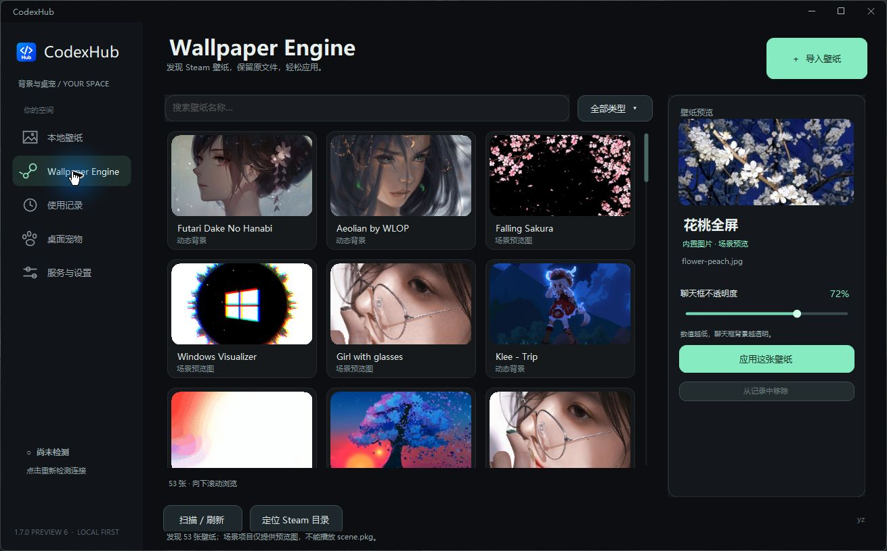
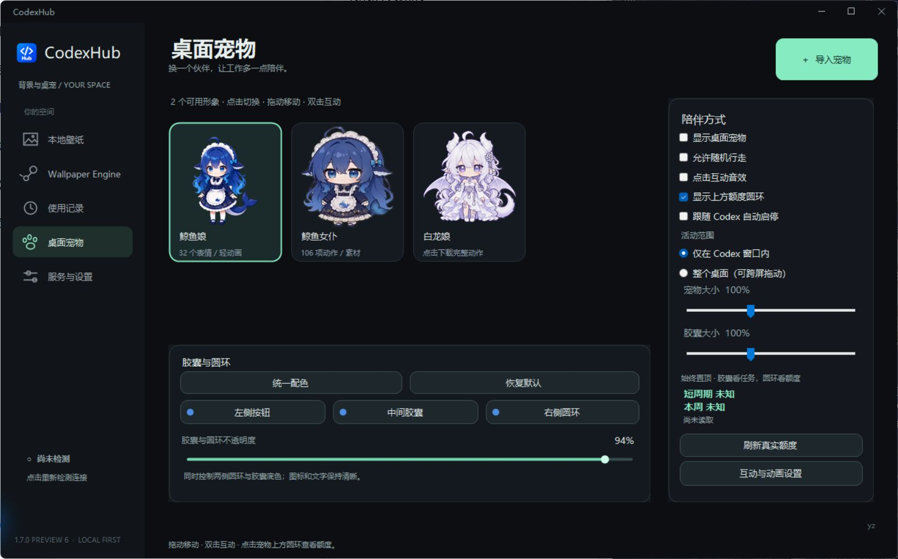
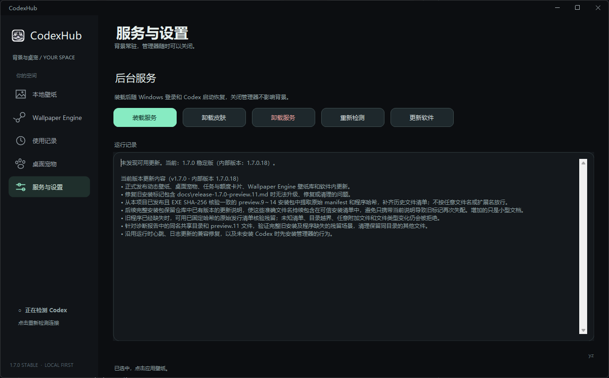

# CodexHub Codex动态壁纸+桌面宠物

  
  
  
  

让 Codex 换上喜欢的风景，也有一个会动的小伙伴。动态背景、桌面宠物、任务和额度卡片，都放在一个 Windows 软件里。

  

**[预览版详情](https://github.com/chenyan-image/codex-live-background/releases/tag/v1.7.0-preview.10) · [稳定版](https://github.com/chenyan-image/codex-live-background/releases/latest) · [更新记录](CHANGELOG.md)**

## 壁纸与背景

- 支持 4K 视频；优先原画质，无法解码时自动生成兼容副本。
- 图片按比例裁切铺满 Codex，覆盖侧栏和对话区域；聊天框透明度可调。
- 自动扫描 Wallpaper Engine，支持搜索、筛选、连续向下滚动和预览。
- 保存壁纸使用记录；新装仅附《花桃全屏》静态背景，其他壁纸自行导入或从 Wallpaper Engine 选择。升级保留已有素材。
- 下载和导入在后台进行，宠物及卡片动画继续运行。
- 静态缩略图只保留一帧，隐藏预览释放图片；宠物动作采用限量缓存，降低后台常驻占用。

## 桌面宠物

| 鲸鱼娘 | 鲸鱼女仆 | 白龙娘 |
| :---: | :---: | :---: |
| 随安装包提供，32 项表情与轻动画 | 随安装包提供，106 段完整透明动画 | 点击从作者 GitHub 下载，或复用本机的 25 段完整动画 |

- 拖动、惯性滑行、随机行走、碰撞反馈，右键可选择各自的动作。
- 活动范围可设为 Codex 内或整个桌面；Codex 内模式只识别主窗口，不跟随任务栏右键菜单。只有手动跨屏拖动才换屏，自主运动在当前屏幕内回弹。
- 可按需开启“跟随 Codex 自动启停”，默认关闭：Codex 最小化、隐藏或关闭时同步退出，打开或恢复可见时自动从托盘启动；仅切换焦点时宠物继续陪伴。检测复用已有背景守护进程，更新程序只在安装更新时短暂运行。
- 任务开始进入工作，结束播放完成动作；空闲动作轮换，长时间无任务只进入一次休息。碎碎念与离线聊天已取消。点击与自动动作不会连续重复，固定模式稍微提高随机动作频率。
- 点击胶囊看当前任务，点击圆环看剩余额度、重置时间与 Token 曲线。卡片平滑展开，跟随宠物继续移动；单击宠物刷新额度并收起卡片。刷新平滑完成整圈后，成功显示短暂对勾，失败保留错误提示。
- 展开任务卡片跟随胶囊颜色，额度卡片跟随圆环颜色。“统一配色”一次更改左侧 Hub 按钮、中间胶囊和右侧圆环，也可分别选色；左右圆环和胶囊共用 0%～100% 不透明度滑条，实时预览；透明圆环使用白字和深色描边，百分比保持清楚。
- 深色圆角色盘支持连续选色、精选色卡及 HEX／RGB 输入，确认后应用；程序更新后在运行记录显示修改内容。
- 宠物与胶囊分别调节，范围均为 70%～150%。鲸鱼女仆新 100% 对应此前 80% 的实际大小，胶囊比例独立。
- 鲸鱼女仆的没钱系列仅在真实剩余额度低于 10% 时自动随机播放。

## 安装、更新与后台运行

1. [下载 `CodexHub-1.7.0-preview.10-Setup.exe`](https://github.com/chenyan-image/codex-live-background/releases/download/v1.7.0-preview.10/CodexHub-1.7.0-preview.10-Setup.exe)，选择安装目录，无需解压。
2. 选择或导入壁纸，预览后点击应用；按需启用桌面宠物。
3. 在 **服务与设置 → 更新软件** 获取 GitHub 程序更新。更新包只替换程序，壁纸、宠物素材、设置和记录保留；每次启动通过公开频道检查 GitHub 更新，避免匿名 API 限流；有新版时在更新按钮上显示小红点，点击后才安装。

最小化或关闭管理器会隐藏到托盘，不占任务栏；背景服务随 Windows 登录和 Codex 启动恢复。完整卸载可运行安装目录中的“卸载 CodexHub.exe”。

适用 Windows 10 / 11 x64 与官方 Codex。稳定主线仍为 v1.5.4.5，宠物功能位于 `feature/pet-companion`。首次启用背景连接若遇普通启动实例，请保存输入并手动完全退出 Codex 一次。

## 支持格式

| 类型 | 文件格式 | 支持与处理方式 |
| --- | --- | --- |
| 视频 | **MP4** | 支持 H.264 / AVC、H.265 / HEVC；AV1、分片 MP4 等需要兼容处理的输入会先转换，再验证实际解码。 |
| 视频 | **WebM** | 支持 VP8 / VP9 输入，需要时生成 VP9 兼容副本。 |
| 动图 | **GIF** | 循环播放，可直接作为动态背景。 |
| 图片 | **PNG** | 按比例裁切铺满窗口，保留聊天框透明度设置。 |
| 图片 | **JPG / JPEG** | 支持横图、方图和竖图，自动适配窗口。 |
| 图片 | **WebP** | 可导入、预览并应用为图片背景。 |
| Wallpaper Engine | **视频 / GIF / 图片项目** | 自动扫描 Steam 库，也可手动定位目录；支持搜索、筛选和预览。 |
| Wallpaper Engine | **scene.pkg / 网页 / 应用项目** | 有预览图时可使用预览图，原场景动画、网页和程序不能直接播放。 |

| 项目 | 范围与限制 |
| --- | --- |
| 主题名称 / 壁纸标题 | 最多 **4096 个 Unicode 码点**；组合表情按所含码点计数，名称不允许换行或控制字符。 |
| **4K 视频** | 原画质优先；需要兼容转换时，先保留源尺寸（长边最高 4096），再按需降至长边 2560、1920 像素。 |
| 文件大小 | 视频源文件最大 **2 GiB**，图片最大 **512 MiB**；最终播放副本最大 **512 MiB**。 |
| 视频时长与帧率 | 最长 **10 分钟**，输入最高 **120 FPS**；兼容副本最高 **30 FPS**。 |
| 分辨率与动画 | 单边最高 **16384 像素**，总像素最高 **50 MP**；图片动画最多 **300 帧**。 |
| 播放方式 | 视频静音循环；转换保留完整时长，原素材不被修改。 |

鲸鱼女仆的完整动画已经内置；为减小安装包，通用播放／视频转换组件首次需要时下载并校验，之后复用本机缓存，已有组件保留。[兼容与离线使用说明](docs/guide.md#首次转换需要的下载)

## 项目来源

原始背景管理器：[xxloocee/Codex-Dream-Skin-Manager](https://github.com/xxloocee/Codex-Dream-Skin-Manager)，底层引擎：[Fei-Away/Codex-Dream-Skin](https://github.com/Fei-Away/Codex-Dream-Skin)。本项目在其基础上修复 Bug、简化源码并改进 Windows 体验。

[MIT](LICENSE) · [第三方声明](THIRD_PARTY_NOTICES.md) · [素材说明](THIRD_PARTY/Pet-Assets/README.md) · [构建与详细说明](docs/guide.md)

本工具为非官方项目，与 OpenAI 无隶属关系。当前发行尚未正式代码签名，[Windows 提示说明](docs/windows-trust.md)。
