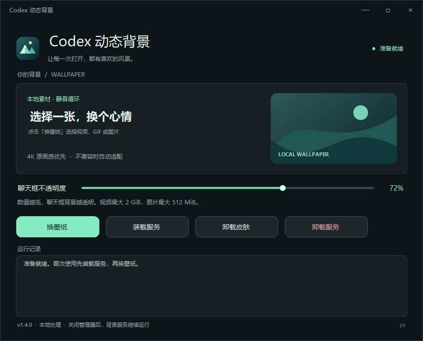

# 详细使用与开发说明

> **原项目的 Bug 修复与源码精简版。** 原始软件由 [xxloocee / Codex-Dream-Skin-Manager](https://github.com/xxloocee/Codex-Dream-Skin-Manager) 提供；底层皮肤引擎来自 [Fei-Away / Codex-Dream-Skin](https://github.com/Fei-Away/Codex-Dream-Skin)。本仓库主要修复使用中遇到的 Bug、简化管理器与源文件并补充 Windows 兼容处理，不将原项目及其主要功能标为我们原创。

`codex-live-background` 为 Windows 上的官方 Codex 稳定版添加本地图片、GIF 和视频背景，支持静音循环与登录后自动恢复。

这是基于开源 Dream Skin 引擎的**非官方定制工具**，与 OpenAI 不存在隶属、认可或赞助关系。它不会修改 Codex 的应用安装文件。OpenAI、Codex 和 ChatGPT 的名称、商标及相关权利不属于本项目的 MIT 授权范围。



## 适用环境

- Windows 10 / 11，x64。
- 当前 Windows 用户已安装官方 Codex 稳定版商店包 `OpenAI.Codex`。
- 不支持未验证的 Beta 包、ChatGPT Classic、网页端、macOS、Linux 或 ARM64。
- 发布包自带经过签名验证的 Node.js，无需单独安装 Node.js 或 Python。

Codex 后续更新可能改变界面或启动行为；出现不兼容时请使用本仓库较新的发布版本。

## 使用

从本仓库 **[Releases](https://github.com/chenyan-image/codex-live-background/releases/latest)** 下载 **`Codex-Background-1.5.4.3-Setup.exe`**，双击安装，无需手动解压。可填写其他本地盘的专用目录，例如 `D:\Apps\CodexLiveBackground`。程序与后台组件统一放在所选目录，桌面仅一个管理器图标。安装窗持续显示步骤和运行记录，直到出现成功或失败结果；完成后从桌面正常打开管理器。失败时显示日志与恢复文件位置。

这是 **v1.5.4 基线的安装维护修复版**，管理器和壁纸引擎恢复到该版行为，不包含 v1.5.5 的主动连接与定时重试。v1.6.0–v1.6.2 已撤回推荐。新装和新版卸载不使用 MSI；只有迁移已安装的历史 MSI 时才调用 Windows Installer 正式移除旧产品。

管理器采用黑色壁纸库界面，按侧栏浏览：

| 页面 | 作用 |
| --- | --- |
| 本地壁纸 | 六张内置原创背景、导入的本地视频或图片，支持搜索、静态/动态过滤和分页。 |
| Wallpaper Engine | 自动发现 Steam 库中的视频、GIF、图片；所有匹配结果在同一列表中向下滚动，无需翻页。未发现时可手动定位 Steam 库或 `431960` 目录。 |
| 使用记录 | 按最近成功应用的时间排列，重开软件仍保留；移除记录不会删除原文件。 |
| 服务与设置 | 装载服务、卸载皮肤、卸载服务、连接 Codex以及运行记录。 |

点击右上角「导入壁纸」添加本地文件，或在卡片中选择内置/Steam 壁纸，再点右侧「应用这张壁纸」。导入和预览不会更改当前背景，成功应用后才写入使用记录。EXE 安装会配置后台服务，服务页可再次装载。关闭管理器不会停止后台服务，登录后也不会自动弹出管理器窗口。拖动滑杆调整聊天框背景的不透明度：数值越低越透明。换壁纸时会同步启用 Codex 深色外观，避免浅色界面覆盖背景。

Wallpaper Engine 列表支持鼠标滚轮和右侧深色滚动条，按需加载屏幕附近的卡片。搜索或切换静态/动态类型后回到列表顶部；滚动不影响已选壁纸和右侧预览。本地壁纸与使用记录沿用分页。

左下角显示真实 Codex 连接状态、版本及背景服务状态，点击可重新检测；只有核验通过的 Codex 会话才显示绿色。六张内置背景由本仓库代码生成；个人或 Steam 壁纸需自行导入或扫描。界面组织参考 [JiPaiFan1109/CodexPage](https://github.com/JiPaiFan1109/CodexPage)，黑色布局和交互独立实现。

Wallpaper Engine 的 `scene.pkg`、网页及应用项目无法直接播放；有预览图时会明确显示为「场景预览图」，应用的是预览图而非原场景动画。不会执行壁纸项目脚本或修改 Steam 文件。壁纸库只记录原文件路径，文件被移动或磁盘离线后会显示不可用，可重新导入；不会批量复制或删除 Steam 壁纸。

选中素材后，右侧显示实际预览：图片直接显示，视频和 GIF 优先显示 384×216 / 12 FPS 预览，失败时依次降低至 256×144 / 8 FPS、192×108 / 6 FPS，再尝试静态缩略图；最长 6 秒，实际背景保留完整时长。生成预览需要相同的可选 FFmpeg 运行时，预览不可用时仍会继续尝试应用壁纸。

已有背景连接的 Codex 窗口可以直接更换壁纸。若首次启用时 Codex 是普通启动实例，请先保存未发送的输入，手动完全退出 Codex 一次，再点「应用这张壁纸」。工具不会强制关闭或重启聊天。独立背景配置首次使用时可能需要重新登录。


视频应用会校验实际解码画面；管理器遮住或 Codex 暂时隐藏时，也能完成解码校验。窗口隐藏期间背景暂停以减少开销，重新显示后恢复。左下角「连接就绪」只代表连接可用，下一行会显示视频播放、等待窗口显示、暂停、加载或错误等实际状态。

图片在全窗口模式下按比例裁切铺满，不再按横图、方图或竖图决定覆盖范围；不会拉伸变形。聊天框透明度仍可单独调整。

## 素材与兼容转换

主题名称和壁纸标题最多支持 **4096 个 Unicode 码点**，中文、英文和表情可用；组合表情按所含码点计数。导入、保存、主题包校验和背景加载使用统一上限，名称不能包含换行或控制字符。Steam 标题不再截到 160 字符，界面按原布局省略显示，完整内容保存在配置及使用记录中。

| 素材 | 支持范围 |
| --- | --- |
| MP4 | 支持 4K H.264 / AVC、H.265 / HEVC、AV1 输入；分片或不能直接播放的文件会先标准化。 |
| WebM | VP8 / VP9 输入；需要时转为单视频轨、无音轨的 VP9 兼容副本。 |
| 图片和动画 | GIF、PNG、JPG / JPEG、WebP。 |
| 大小 | 视频源文件最大 2 GiB，图片最大 512 MiB；最终播放副本最大 512 MiB。 |
| 视频时长与帧率 | 最长 10 分钟，最高 120 FPS。 |
| 像素尺寸 | 单边不超过 16384 像素，总像素不超过 50 MP。 |
| 图片动画 | 最多 300 帧；该限制不用于计算视频帧数。 |

动态素材静音循环播放。成功应用后的背景保存播放副本，移动原文件不影响当前效果；壁纸库引用原文件，移动原文件后原记录将无法再次应用。

**4K 原画质优先。** 能直接播放的标准文件保留原始分辨率和帧率。需要转换时，先尝试保留源分辨率（长边最高 4096 像素）的 **VP9 WebM 兼容副本**；若此电脑仍不能解码，再依次尝试长边 2560、1920 像素。不放大小视频。兼容副本保留完整时长，关闭音频，最高 30 FPS。

分片 MP4、AV1 或超过 512 MiB 的视频源文件先用经过校验的本地 FFprobe 读取信息，再生成符合播放要求的副本。大文件采用流式哈希校验。每一级副本必须通过文件结构、完整时长和当前 Codex 的真实解码帧验证后才应用；成功的清晰度会缓存，重复选择相同素材无需重新转换。4K 解码超时也可逐级降低分辨率；这不保证低性能电脑能流畅播放所有视频。

播放权限被拒绝、播放中断或窗口隐藏会分别提示，不会误当作编码问题转换视频。导入失败时保留现有壁纸，原文件始终不变。

### 首次转换需要的下载

首次生成动态预览、标准化或兼容转换时，程序从 **BtbN/FFmpeg-Builds** 的固定发行下载约 **74 MiB** 的 LGPL shared Windows x64 运行时 ZIP，核对固定 SHA-256 后仅解压白名单组件（包括 FFprobe）。之后复用本机运行时。项目发布 ZIP 不包含 FFmpeg 二进制，也不会上传视频。

离线电脑可在另一台电脑下载同一个原始 ZIP，将它原封不动放在目标电脑的：

```text
%LOCALAPPDATA%\CodexDreamSkin\runtime-downloads\ffmpeg-n9.0.2-17-g2a571b6068-win64-lgpl-shared-9.0.zip
```

不需要手动解压或改名。软件仍会验证同一 SHA-256。精确下载地址、校验值、许可及对应源码见 [FFmpeg 运行时说明](../ffmpeg-notices/README.md) 和 `runtime-download.json`。长视频首次转换可能需要几分钟，进度显示在管理器中。

## 自启动、文件位置与诊断

| 内容 | 当前用户目录或入口 |
| --- | --- |
| 程序安装位置 | 安装时自定义；默认 `%LOCALAPPDATA%\Programs\CodexLiveBackground`，后台组件在所选目录的 `startup` 子目录 |
| 背景、兼容副本和运行时 | `%LOCALAPPDATA%\CodexDreamSkin` |
| 后台日志 | 所选安装目录的 `startup` 子目录 |
| 最近的视频诊断 | `%LOCALAPPDATA%\CodexDreamSkin\last-video-diagnostic.json` |
| 壁纸库、使用记录与 Steam 目录 | `%LOCALAPPDATA%\CodexDreamSkin\wallpaper-library.json` |
| 本机官方 Codex 图标缓存 | `%LOCALAPPDATA%\CodexDreamSkin\icons` |
| 登录启动入口 | `CodexDreamSkinPort` 当前用户登录计划任务 |

仅保留一个可在任务计划程序中查看的当前用户登录任务；Codex 包启动入口会检查并补启守护服务。管理器不需要常驻，也不会随 Codex 弹出。「装载服务」会检查真实监控心跳，安装器会自动迁移已识别的旧版。连接仅使用本机 `127.0.0.1:9335`，无需开放公网防火墙规则。

视频诊断用于区分播放策略、格式与解码问题，仅保存在本机，不读取聊天内容，也不会自动发送。提交 Issue 前请检查并删除不愿公开的文件名、路径和其他个人信息。

## 升级与卸载

直接运行新版 Setup EXE，可选择本地其他盘的专用目录。安装器检查注册路径及历史标准目录，按管理器哈希识别旧 ZIP / 1.0.x，按已知产品 ID 识别旧 MSI；没有旧版时直接安装。先解除旧自启动与挂接、停止并核验本项目进程，再迁移旧安装。未知文件和未识别程序不会强行覆盖，正常 Codex 聊天不会关闭。

旧 MSI 需要一次正式迁移：先备份并直接清理已核验的旧组件文件，再由 Windows Installer 注销旧产品，避免这些文件进入跨盘回滚备份。若 Windows Installer 缓存缺失，优先查找下载目录、桌面或安装包旁的同版原始 MSI，找不到时从本仓库旧发行版下载，核对固定 SHA-256 后恢复缓存。此过程可能需要原账号 UAC 和网络，失败保留日志及恢复材料并停止覆盖。切换到其他 Windows 账号授权会被拒绝。

新版 EXE 的「只卸载旧版本」可独立执行上述清理，不安装新程序。历史卸载入口报权限错误时，可以改用这个入口；不必重复运行旧 MSI。具体 Windows 策略或安装器损坏仍可能阻止迁移，错误会显示在日志中。

桌面只保留「Codex 动态背景」管理器图标。旧版额外生成的「Codex（动态背景）」图标经归属核验后移除，任务栏既有 Codex 入口仍可使用。

**卸载整个软件：** 双击安装目录中的 **`卸载 Codex 动态背景.exe`**，或在 Windows 设置的「已安装的应用」中卸载。独立工具先复制自身到临时目录，再显示卸载窗口，避免自身占用安装文件。确认后解除服务与挂接，停止归属已核验的管理器、守护、监控、注入、预览、转码及控制进程，核验退出后删除程序、生成的壁纸副本、预览、下载的 FFmpeg 运行时、日志和记录。新版卸载直接执行，不依赖 MSI 缓存。

**保留内容：** Steam、桌面等外部位置的壁纸原文件不删除。`%LOCALAPPDATA%\CodexDreamSkin\cdp-profile` 可能包含 Codex 登录及聊天相关资料，卸载时保留；因此数据目录可能仍存在，但其中不再运行背景服务。未知用户文件及包含联接的异常路径不会被递归删除。

「卸载皮肤」仅移除当前效果；「卸载服务」停用并解除后台组件，管理器程序保留，便于重新装载。彻底删除程序请使用上述独立卸载工具。

### 跨盘安装出现 1926 / 拒绝访问

若旧版卸载或升级在 `D:\Config.Msi\*.rbf` 报“无法设置文件安全”，先退出当前失败安装，再使用 v1.5.4.3 Setup EXE 的安装／修复或「只卸载旧版本」。新包会按上文迁移已识别的 MSI；请完成原账号的 UAC 授权。操作窗口会保留至结束，失败时保留备份和日志。

工具不删除整个 Config.Msi、不改变盘根权限，也不关闭 Windows Installer 回滚。迁移链路已做隔离测试，现场是否成功以安装结果为准。

## 从源码构建

源码布局：

```text
source/       Windows 管理器、控制脚本和构建脚本
engine/       Dream Skin 引擎及本项目的兼容性修改
startup/      本地端口启动钩子与监控源码
THIRD_PARTY/  第三方许可证、来源和运行时下载配置
```

构建需要 Windows x64、Windows PowerShell 5.1、系统 .NET Framework C# 编译器，以及来自官方发行且签名有效的 Node.js x64 22 或更高版本及其 LICENSE。以下变量填写本地 Node.js 文件位置：

```powershell
$nodeExe = Read-Host 'Node.js node.exe 的完整路径'
$nodeLicense = Read-Host 'Node.js LICENSE 的完整路径'
.\source\build.ps1 `
  -EngineSource .\engine `
  -NodeExecutable $nodeExe `
  -NodeLicense $nodeLicense `
  -PortSource .\startup `
  -ThirdPartySource .\THIRD_PARTY `
  -OutputDirectory .\dist\Codex-Background-local-win-x64
```

输出目录必须是尚不存在的新目录。构建生成六张轻量原创背景，不附带用户或 Workshop 媒体；账号凭据、聊天记录及本机配置不进入安装包。

将上述输出目录压缩为 ZIP 负载，再编译单文件 EXE（ZIP 不作为用户下载入口）：

```powershell
Add-Type -AssemblyName System.IO.Compression.FileSystem
[IO.Compression.ZipFile]::CreateFromDirectory( `
  (Join-Path $PWD 'dist\Codex-Background-local-win-x64'), `
  (Join-Path $PWD 'dist\payload.zip'))
.\source\build-setup.ps1 -PackageZip .\dist\payload.zip `
  -IconFile .\dist\Codex-Background-local-win-x64\CodexBackground.ico `
  -OutputFile .\dist\Codex-Background-1.5.4.3-Setup.exe
```

EXE 内嵌负载哈希及文件清单，安装前校验；安装时复制自身作为独立卸载工具，无递归嵌套。历史 `build-msi.ps1` 仅保留供旧版本维护。代码签名流程见 [Windows 发布与签名](windows-trust.md)。

## 验证源码

使用 Node.js 22 或更高版本，在 Windows 下运行：

~~~powershell
node tests/video-playback-regression.mjs
node tests/webm-validation.mjs
~~~

这些回归不连接 Codex，也不更改当前壁纸；测试媒体是 FFmpeg 生成的小尺寸图案。

## 分支和版本

- `main`：稳定主线，正式版本由 `vX.Y.Z` 标签标记。
- `develop`：下一版本的集成开发分支。
- `feat/<名称>`、`fix/<名称>`：独立功能和修复分支。
- 每个完成的修改都使用独立、明确命名的提交和带说明的 `change/<序号>-<短名>` 标签，方便回溯。

历史功能见 [CHANGELOG](../CHANGELOG.md)，参与开发前请读 [CONTRIBUTING](../CONTRIBUTING.md)。从旧发布包恢复的历史标签对应实际快照，不代表凭空补造旧提交日期。

## 来源和许可

本项目的软件代码按 [MIT License](../LICENSE) 分发，并保留以下项目的版权和许可声明：

- [Codex Dream Skin Manager](https://github.com/xxloocee/Codex-Dream-Skin-Manager)：Windows 管理器与引擎整合的来源。
- [Codex Dream Skin](https://github.com/Fei-Away/Codex-Dream-Skin)：背景注入引擎，MIT。
- [Node.js](https://nodejs.org/)：发布包中的脚本运行时，许可随包保留。
- [BtbN/FFmpeg-Builds](https://github.com/BtbN/FFmpeg-Builds)：可选下载的 LGPL shared 运行时，用于生成 VP9 兼容副本。

详细说明见 [第三方声明](../THIRD_PARTY_NOTICES.md) 和 `THIRD_PARTY`。软件许可证不授予用户壁纸、第三方图片、人物肖像、角色、商标或 OpenAI 应用本身的使用和再分发权；请仅使用自己有权使用的素材。
